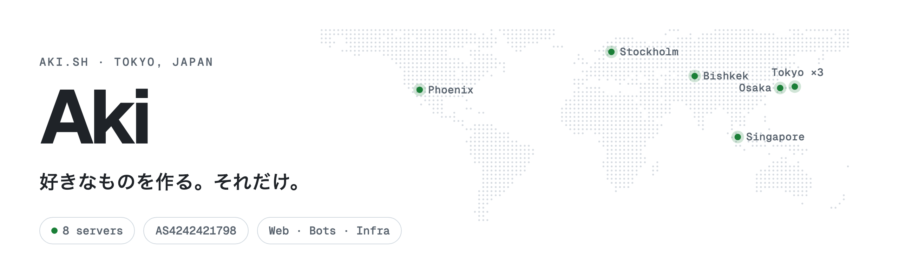

<picture>
  <source media="(prefers-color-scheme: dark)" srcset="assets/banner-dark.png">
  
</picture>

東京に住む高校1年生です。Web サイトや Discord Bot を作ったり、自分のサーバーを動かしたりしています。 
A high school student in Tokyo. I build websites and Discord bots, and run my own servers.

### Running

- **[aki.sh](https://aki.sh)** — ポートフォリオ · Portfolio
- **[net.aki.sh](https://net.aki.sh)** — IP・DNS・メールの設定を調べるツール · Network checks
- **[dns.aki.sh](https://dns.aki.sh)** — 誰でも使える DNS（DoH · DoT · DoQ）· Public resolver
- **[NTP / NTS](https://ntp-jp.aki.sh)** — 大阪・シンガポール・フェニックスの公開時刻サーバー · Public time servers
- **[dn42](https://dn42.aki.sh)** — AS4242421798、大阪・シンガポール・フェニックスのルーター
- **[Atlas](https://atlas.aki.sh)** — 世界のライブカメラ地図 · Live camera map
- **ADS-B** — 自宅のアンテナで飛行機の電波を受信 · Aircraft tracking from home

### Made

- **[TickCapacity](https://github.com/AxAce67/TickCapacity)** — Minecraft サーバーの性能を測り、快適に遊べる人数を推定する
- **[JapaneseChat](https://github.com/AxAce67/JapaneseChat)** — ローマ字のチャットを日本語（漢字）に変換する
- **[ServerTransfer](https://github.com/AxAce67/ServerTransfer)** — メニューから別のサーバーへ移動（プロキシ不要）
- **[multi-purpose-discord-bot](https://github.com/AxAce67/multi-purpose-discord-bot)** — いろいろできる Discord Bot

### Stack

<!-- commas in srcset separate image candidates, so they are written as %2C -->
<picture>
  <source media="(prefers-color-scheme: dark)" srcset="https://skillicons.dev/icons?i=ts%2Creact%2Cnextjs%2Ctailwind%2Cpython%2Cjava%2Cgo%2Clinux%2Cdocker%2Ccloudflare&theme=dark&perline=10">
  
</picture>

  

[aki.sh](https://aki.sh) · [X @real_Aki](https://x.com/real_Aki) · [hello@aki.sh](mailto:hello@aki.sh)
